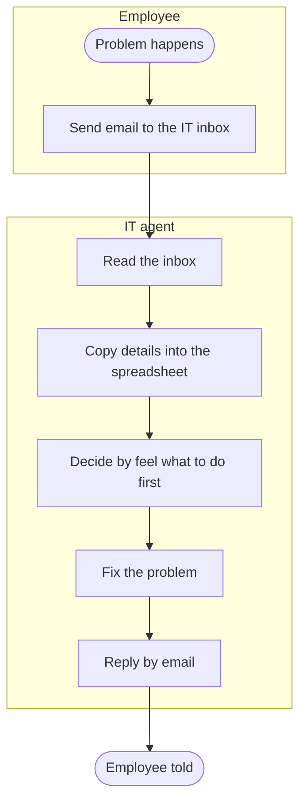
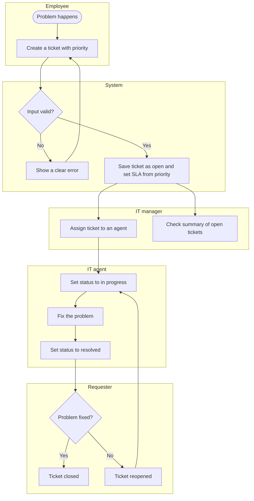
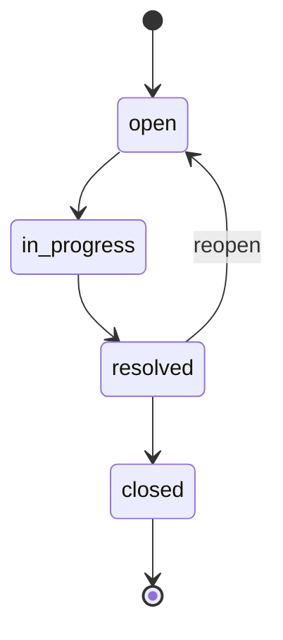

# Process Flows

The diagrams use Mermaid, which GitHub shows as pictures.

## 1. Current state (as-is): email and spreadsheet

Pain points: emails can be missed, there is no priority or deadline, and the manager cannot see the workload.

## 2. Future state (to-be): helpdesk tickets

## 3. Ticket status workflow (business rule BR-02)

